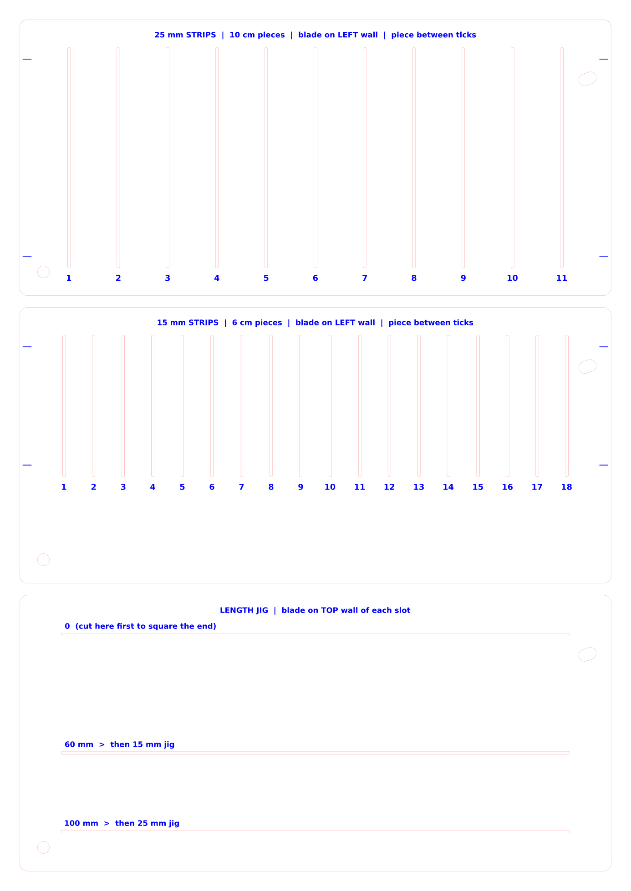

::: {.eyebrow .muted .first .page-top}
Laser cutting files
:::

# Squid strip cutting jigs {.page-title}

::: {.lede}
Three jig plates for cutting squid into even strips: 25 mm strips in 10 cm pieces, 15 mm strips in 6 cm pieces, and a length jig. The files are drawn 1:1 in millimetres.
:::

:::: {.project .page-columns .page-full}
::: {.column-margin}
Plates
: Three, each 300 × 140 mm

Overall layout
: 300 × 432 mm, on a 320 × 452 mm sheet with a 10 mm margin

Layers
: CUT, in red
: ENGRAVE, in blue (labels, numbers and tick marks)

Text
: Already converted to outlines, so no fonts are needed
:::

<h2>Files</h2>

[DXF](squid_jigs_pegged_15x60_25x100.dxf){download="squid_jigs_pegged_15x60_25x100.dxf"}
: For most laser software, with CUT and ENGRAVE layers (DXF 2010, millimetres)

[SVG](squid_jigs_pegged_15x60_25x100.svg){download="squid_jigs_pegged_15x60_25x100.svg"}
: The same drawing as vector artwork, with red cut lines and blue engraving

[PDF](squid_jigs_pegged_15x60_25x100.pdf){download="squid_jigs_pegged_15x60_25x100.pdf"}
: A 1:1 copy for checking, 320 × 452 mm

[All three as a zip](squid_jigs_pegged_15x60_25x100.zip){.button}
::::

{fig-alt="Layout of the three jig plates: a 25 mm strip jig with 11 numbered slots, a 15 mm strip jig with 18 numbered slots, and a length jig with slots at 0, 60 and 100 mm" .column-page-right}

[Barrett Wolfe, Institute for Marine and Antarctic Studies, University of Tasmania · [barrett.wolfe@utas.edu.au](mailto:barrett.wolfe@utas.edu.au)]{.credit .page-end-note}
